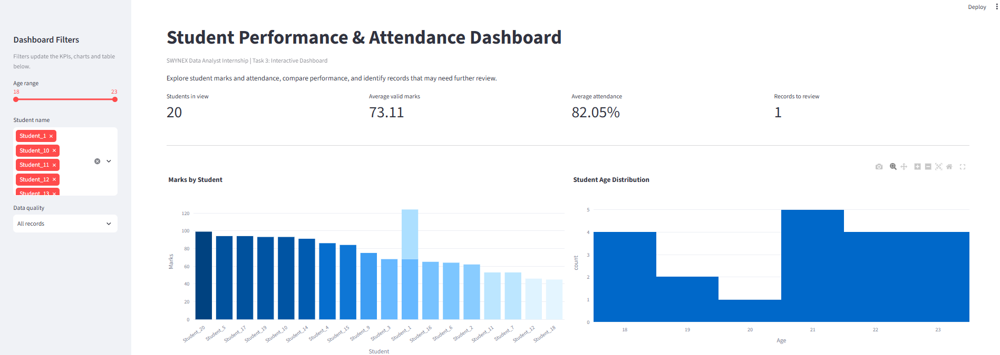
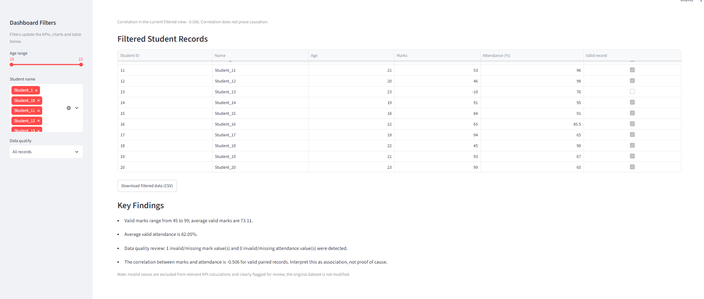
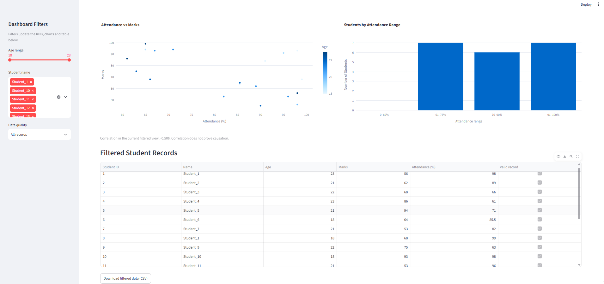

# SWYNEX Data Analyst Internship — Task 3: Interactive Dashboard

## Overview
An interactive student performance dashboard built with Python, Streamlit, Pandas and Plotly.

## Dashboard Features
- KPI cards for student count, average valid marks, average valid attendance and records needing review
- Student marks bar chart
- Age distribution chart
- Attendance vs marks scatter plot
- Attendance-range comparison
- Sidebar filters for age, student name and data quality
- Filtered data table and CSV download
- Key findings and data-quality notes

## Dashboard Screenshots

### 1. Dashboard Overview


### 2. Data Exploration


### 3. Performance Analysis


## Dataset Setup
1. The provided cleaned dataset is already included at `data/cleaned_student_data.csv`.
2. If you update the dataset in Task 2, replace this file with the latest cleaned version.
3. Required columns:
   - `student_id`
   - `name`
   - `age`
   - `marks`
   - `attendance_percentage`

The dashboard flags marks and attendance outside the 0–100 range. It does not change the source CSV.

## Technologies Used
- Python
- Streamlit
- Pandas
- Plotly

## Run Locally (Windows / VS Code)

1. Open the project folder in VS Code.
2. Open the terminal.
3. Install the required libraries:

```powershell
python -m pip install -r requirements.txt
```

4. Run the Streamlit application:

```powershell
python -m streamlit run app.py
```

The dashboard should open in your browser. If it does not, open the local address printed in the terminal.

## Deploy on Streamlit Community Cloud

1. Upload this project to a GitHub repository.
2. Ensure `app.py`, `requirements.txt`, and `data/cleaned_student_data.csv` are included.
3. Open Streamlit Community Cloud and connect the repository.
4. Choose `app.py` as the main file and deploy.

## Suggested Submission Evidence
- Screenshot of the full dashboard
- Screenshot showing filters being used
- GitHub repository URL
- Live dashboard URL (if deployed)
- README explaining tools, features and findings
